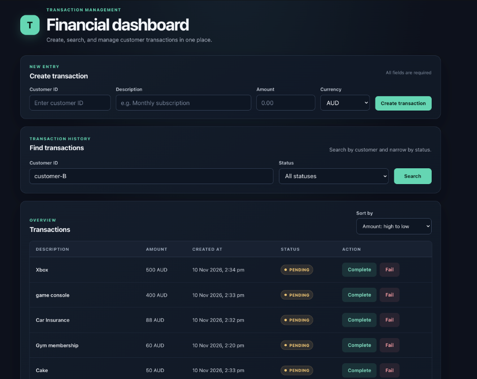

# Transaction Management App

A full-stack transaction management application with a React and TypeScript dashboard backed by a Java Spring Boot REST API. Create transactions, find them by customer, filter and sort paginated results, and update the status of pending transactions.

## Dashboard



## Features

- Create transactions with a customer ID, description, amount and currency
- Search transactions by customer ID and optionally filter by `PENDING`, `COMPLETED` or `FAILED` status
- Sort and paginate transaction results through the backend API
- Complete or fail pending transactions, with invalid state transitions rejected
- Retrieve a transaction by ID through the REST API
- Make transaction creation idempotent with an `Idempotency-Key`, including safe handling of concurrent duplicate requests and mismatched key reuse
- Use optimistic locking to protect concurrent transaction updates
- Validate requests and return consistent API errors
- Verify domain, service and API behavior with automated unit and integration tests

## Tech Stack

| Area | Technologies |
| --- | --- |
| Frontend | React, TypeScript, Vite |
| Backend | Java 21, Spring Boot, Spring Data JPA |
| Database | H2 for local development/testing, PostgreSQL-ready |
| Testing | JUnit 5, Mockito, MockMvc |
| API Style | REST / JSON |

## Project Structure

```text
transaction-management-app/
├── frontend/       # React and TypeScript client
├── backend/        # Java Spring Boot REST API
├── README.md
└── .gitignore